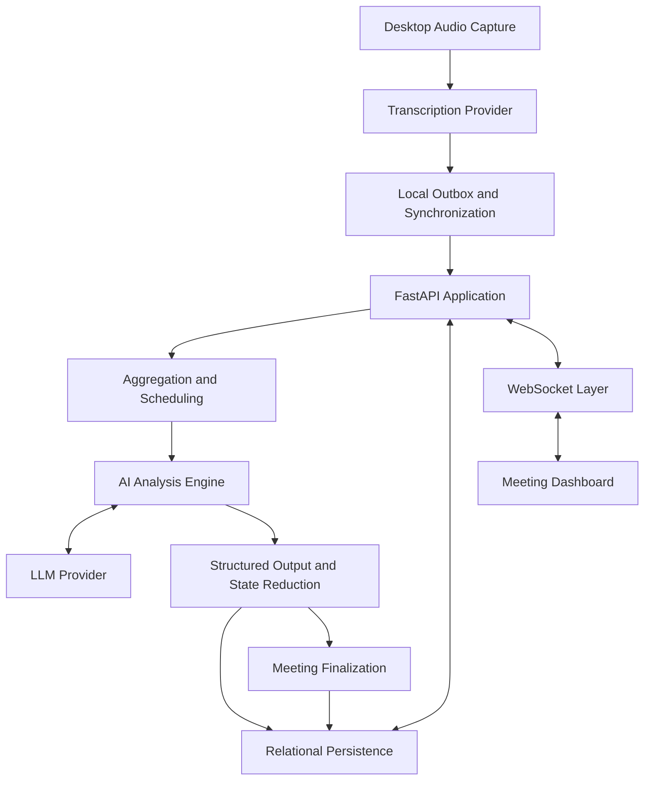

# MeetingsAI | AI Meeting Intelligence Platform


## Executive Overview

MeetingsAI is an independently developed AI meeting intelligence
platform designed to transform meeting conversations into
structured, actionable business intelligence.

The solution combines desktop-based audio capture and transcription
with server-side aggregation, contextual AI analysis, topic
intelligence, meeting state management and finalization.

**Application portal:** https://meetingsai.omchat.ovh

This repository is a curated technical portfolio snapshot,
separate from the private operational repository.

## Business Objectives

- Reduce manual meeting documentation.
- Improve visibility into decisions and action items.
- Identify discussion topics and context gaps.
- Maintain structured meeting state.
- Support timely meeting insights and final summaries.
- Improve continuity through resilient client-server synchronization.

## Logical Solution Architecture



The diagram represents the conceptual component architecture,
rather than a complete production deployment topology.

## Core Capabilities

| Capability | Engineering Approach |
|---|---|
| Audio capture | Desktop recorder and device abstraction |
| Transcription | Provider-based integration |
| Synchronization | Local outbox and synchronization modules |
| Meeting ingestion | FastAPI and WebSocket interfaces |
| Rolling analysis | Aggregation and scheduled AI processing |
| Context review | Context-gap models and review reducers |
| Topic intelligence | Detection, parsing, research and scheduling |
| State management | Structured state and delta reduction |
| Finalization | Dedicated finalization engine and API |
| Provider governance | Topic-provider budget models |
| Security | Authentication, configuration and rate-limiting modules |
| Observability | Structured logging and health interfaces |

## Technology Stack

| Layer | Technology |
|---|---|
| Language | Python 3.12+ |
| Backend | FastAPI, Uvicorn |
| AI integration | OpenAI SDK |
| Real-time communication | WebSockets |
| Persistence | SQLAlchemy, PyMySQL |
| Schema validation | Pydantic |
| Migration tooling | Alembic dependency |
| Authentication tooling | Argon2 |
| HTTP integration | HTTPX |
| Logging | Structlog |
| Presentation | JavaScript, CSS, Jinja2 dependency |
| Testing | Pytest, Pytest-Asyncio |
| Code quality | Ruff |

## Architectural Design Decisions

### ADR-001: Separate desktop capture from server processing

The recorder handles local capture and transcription integration.
The server handles aggregation, AI analysis and meeting state.

This separation supports independent evolution of capture and
analysis components.

### ADR-002: Outbox-based synchronization

The recorder includes dedicated outbox and synchronization modules
to support continuity across client-server communication.

### ADR-003: Structured AI outputs

AI processing is organized around prompt management, output schemas,
parsing, state reduction and provider integration.

The design supports structured meeting intelligence rather than
relying exclusively on free-form generated summaries.

### ADR-004: Modular topic intelligence

Topic detection, research, provider integration and scheduling
are separated into dedicated modules.

### ADR-005: Relational meeting state

Dedicated data models represent meetings, transcript segments,
discussion segments, topics, threads, context gaps, state changes
and finalization records.

## Security and Governance

The portfolio includes modules and dependencies supporting:

- Authentication and protected API access.
- Argon2 password-hashing tooling.
- Application configuration management.
- Rate limiting.
- Structured AI output validation.
- Provider budget management.
- Health and application lifecycle monitoring.

Meeting recording and AI processing must be performed with
appropriate consent and organizational authorization.

This portfolio does not claim formal security certification
or regulatory compliance.

## Engineering Quality

The curated repository contains 42 automated test files covering:

- Authentication and configuration.
- Meeting APIs and transcript processing.
- AI output validation and reducers.
- Analysis scheduling and gating.
- Topic detection and research.
- Provider budgeting.
- Meeting finalization.
- WebSocket ingestion resilience.
- Application lifecycle and liveness.
- Recorder outbox and synchronization.

Test inventory is not equivalent to a verified passing test count.

## Repository Structure

```text
app/
  ai/                 AI processing and topic intelligence
  api/                Application API modules
  core/               Configuration and security
  db/                 Database integration
  models/             Relational data models
  prompts/            AI prompt definitions
  schemas/            Structured validation schemas
  services/           Aggregation and scheduling
  websocket/          Real-time communication

client/recorder/      Desktop recorder source and tests
tests/                Application and integration tests
web/static/           Dashboard static assets
pyproject.toml        Dependencies and development tooling
```

## Project Status

This repository demonstrates the architecture and selected
implementation components of MeetingsAI.

Operational configuration, deployment-specific artifacts and
private application data are maintained separately.

The public snapshot is intended for technical architecture
and engineering evaluation. It is not presented as a complete
standalone production deployment package.

## Potential Future Enhancements

- Expanded observability and operational dashboards.
- Automated deployment validation.
- Configurable data retention policies.
- Additional AI provider integrations.
- Enterprise identity integration.
- Formal architecture and security assessments.

## Author

Sachin Tewari

Technology leadership | Enterprise architecture |
Cloud modernization | AI engineering

- GitHub: https://github.com/mailforsachin
- LinkedIn: https://www.linkedin.com/in/tewarisachin/
- Application: https://meetingsai.omchat.ovh

## Intellectual Property

Public visibility does not constitute an open-source license.
No license for reuse is granted by this README.